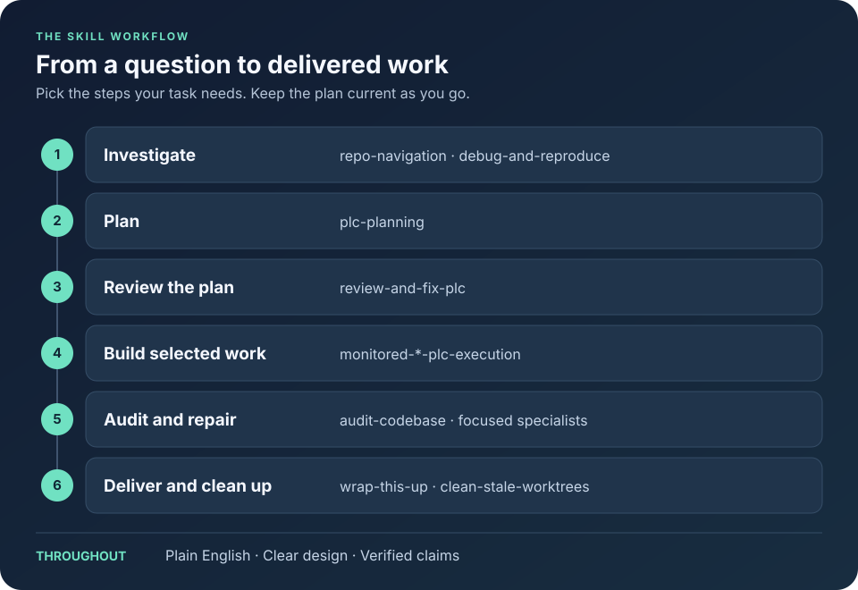

# LLM Tools and Skills

Reusable agent skills, tools, and personal setup. Keep project-specific facts,
design notes, build commands, and rules in the project they describe.

- [`skills`](skills/) contains managed Agent Skills and their installer.
- [`templates`](templates/README.md) has starting `AGENTS.md`, `CLAUDE.md`, and `llms.txt` files for new repositories.
- [`piw`](piw/README.md) runs persistent or disposable Pi sessions in Docker Sandboxes.
- [`agent-dependencies.json`](agent-dependencies.json) pins external skills and agent tools.
- [`agent-runtime.txt`](agent-runtime.txt) pins the Python libraries used by setup commands.

## Use the skills

Describe what you want done. Call a skill with `$skill-name`
in Codex or `/skill-name` in Claude Code. Agents can also choose skills from their
descriptions. Ask explicitly to use a monitored implementation workflow.



### Pick the next step

| When you want to… | Use | Example request |
|---|---|---|
| Understand existing code | [repo-navigation](skills/repo-navigation/SKILL.md) | “Trace how configuration reaches the exporter.” |
| Reproduce a bug | [debug-and-reproduce](skills/debug-and-reproduce/SKILL.md) | “Reproduce this reload failure and fix its cause.” |
| Plan a larger change | [plc-planning](skills/plc-planning/SKILL.md) | “Plan config reloads. Include requirements, steps, and checks.” |
| Improve a written plan | [review-and-fix-plc](skills/review-and-fix-plc/SKILL.md) | “Have a subagent review this plan, then fix supported findings.” |
| Create isolated work | [start-this-up](skills/start-this-up/SKILL.md) | “Start this up in a new branch and worktree from main.” |
| Implement selected plan work | [monitored-sol-plc-execution](skills/monitored-sol-plc-execution/SKILL.md) | “Finish phase 1, including tests and docs. Open an MR; leave it unmerged.” |
| Review a change thoroughly | [audit-codebase](skills/audit-codebase/SKILL.md) | “Audit this branch against main. Report findings without editing.” |
| Handle review feedback | [resolve-review-comments](skills/resolve-review-comments/SKILL.md) | “Check the PR feedback against the source and fix valid issues.” |
| Write or refresh a review description | [create-mr-description](skills/create-mr-description/SKILL.md) | “Update the MR description with examples, change counts, and actual test results.” |
| Save current progress | [wrap-this-up](skills/wrap-this-up/SKILL.md) | “Update the plan with what passed and what remains.” |
| Finish delivery | [wrap-this-up](skills/wrap-this-up/SKILL.md) | “Merge the approved MR, update the plan, and clean up this task’s worktrees.” |
| Remove stale local work | [clean-stale-worktrees](skills/clean-stale-worktrees/SKILL.md) | “Remove finished worktrees. Keep unmerged work.” |

A **PLC** (Plan-Led Change) records requirements, design, delivery phases, and
checks. Small fixes can go straight from investigation to repair and testing.

See [skill workflows](docs/skill-workflows.md) for plan examples, model choices,
and the steps from implementation through delivery.

## Set up a computer

### 1. Install the prerequisites

| Platform | Install |
|---|---|
| All | [Git](https://git-scm.com/downloads) |
| Windows | PowerShell 7: `winget install --id Microsoft.PowerShell -e` |
| Linux/macOS | `curl` or `wget`, and `sha256sum` or `shasum` (most systems already have these) |

You don't need mise, Task, Python, Node, or uv. Bootstrap downloads pinned copies into this
checkout.

On Windows, setup uses the built-in Windows PowerShell 5.1. Agent apps use
PowerShell 7 (`pwsh`); install it with winget. See troubleshooting below if a global
mise installation has taken over `pwsh`.

### 2. Clone this repository

```bash
git clone https://github.com/nccurry/llms.git
cd llms
```

Keep the checkout in a stable place. Agent configuration points to it, so if you move it,
run `agents:configure` again.

### 3. Install everything

Linux/macOS:

```bash
./bootstrap.sh install TARGET=all
```

Windows:

```powershell
powershell -NoProfile -ExecutionPolicy Bypass -File .\bootstrap.ps1 install TARGET=all
```

This installs pinned tools and skills, configures the agents, and runs `doctor`.
`TARGET=all` covers Codex, Claude, Pi, and OpenCode. Use `TARGET=codex`, `claude`, `pi`, or `opencode` for one agent only.

To preview changes, first run bootstrap with no arguments to download the setup
tools, then run `install:dry-run TARGET=all` through the same script.

### 4. Check it works

`install` ends by running `doctor`. Read its report for anything missing. `doctor` checks
installed files and configuration only. Restart your agent apps and try a real query in a
project before relying on a tool.

### Update later

```bash
git pull
./bootstrap.sh install TARGET=all
```

On Windows, run `git pull`, then the same `bootstrap.ps1 install TARGET=all` command as step 3.

Use `skills:install TARGET=all` instead of `install` to update only the skills. Installs are
safe to repeat: unchanged skills are skipped, and changed ones are backed up first.

### Troubleshooting

| Problem | Fix |
|---|---|
| `mise ERROR No version is set for shim: pwsh` | A global mise owns `pwsh` without a version. Run `mise uninstall powershell --all`, then install PowerShell 7 with winget. |
| Agent tools point to an old folder | Run `agents:configure TARGET=all` through bootstrap from the current checkout. |
| A skill install failed | Rerun with `OUTPUT=json`. The report lists backup paths and the failed check. |

## How setup works

Bootstrap downloads the pinned setup tools into `.tools/` and runs commands from
`Taskfile.yml`. It leaves your shell profile, PATH, and global mise setup unchanged.
Run commands through bootstrap, such as `./bootstrap.sh doctor`, or use `task` if
it is already available.

With no arguments, bootstrap prepares the tools and piw development environment.
Use `install TARGET=all` to install skills and configure agents.

See the [setup reference](docs/setup.md) for all commands, version updates,
skill maintenance, and recovery steps.

## Agent tools

| Tool | Main use |
|---|---|
| Serena | Find symbols and references through standard language servers |
| ast-grep | Search structural code patterns through the CLI |
| GitNexus | Query code maps, execution flows, and change impact |
| cq | Store and find lessons from previous debugging locally |
| Ponytail skills | Review code and look for bugs or unnecessary complexity |

The setup above installs and configures these tools.

Run a tool directly with `task tools:run TOOL=ast-grep -- --version`.
GitNexus is enabled for a personal noncommercial trial; resolve licensing before commercial use.

See the [agent tools guide](docs/agent-tools.md) for configuration, Serena sessions and
dashboards, GitNexus indexing and licensing, and dependency updates.

## Development

| Command | Checks |
|---|---|
| `task test` | piw application tests and agent launchers; no live Docker Sandboxes needed |
| `task check` | Formatting, lint, types, coverage, skill validation, and launcher checks |
| `task ci` | All checks above, plus a piw build and a smoke test of the installed package |

Run `task test:agent-launchers` to check only the launchers. If the pinned GitNexus
is installed, these checks also run its real hook. Project commands are available
under `piw:` and `skills:`.

See [skill behavior checks](tests/skill-evals.md) when changing how agents select
or follow skills, and [skill maintenance](docs/setup.md#maintain-installed-skills)
for installer and validation commands.

## piw

Install the current piw checkout as a uv tool:

```bash
task piw:install
```

Or install directly from Git using an available uv:

```bash
uv tool install 'git+https://github.com/nccurry/llms#subdirectory=piw'
```

See the [piw README](piw/README.md) for requirements, configuration, commands, and development.
