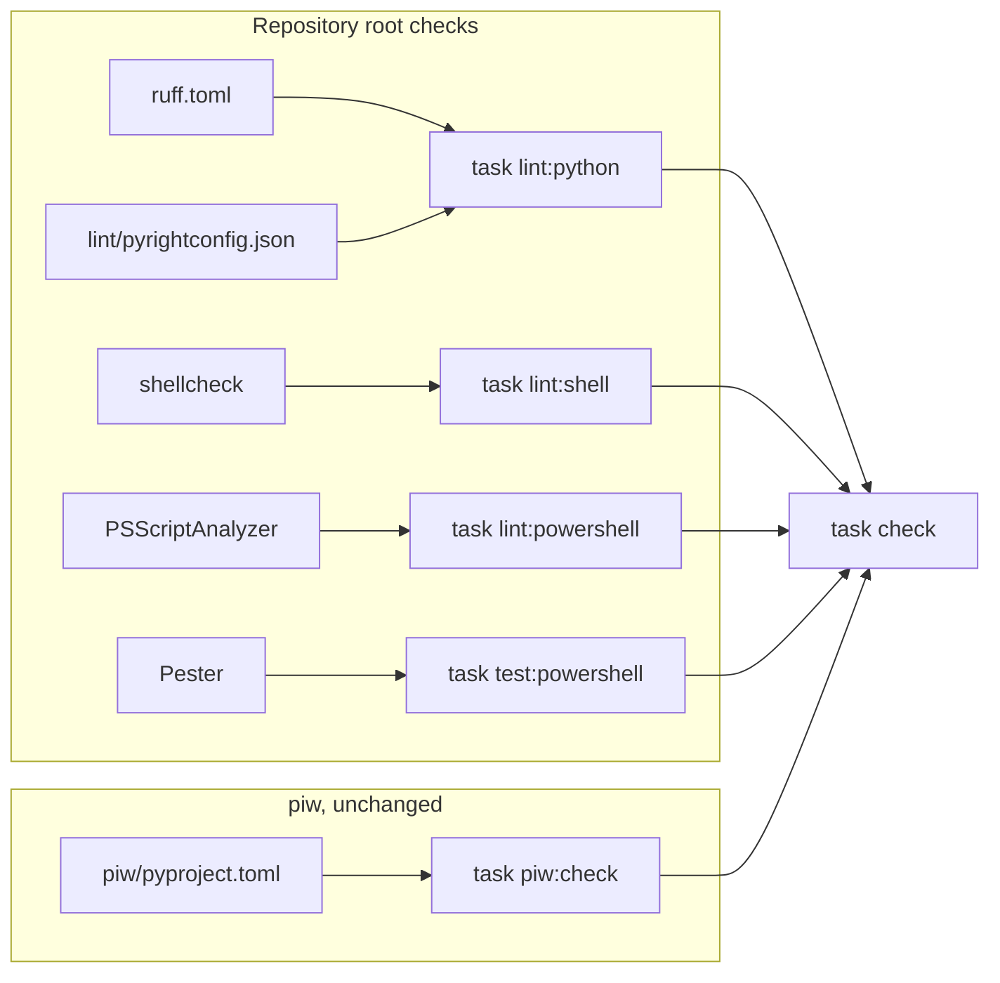
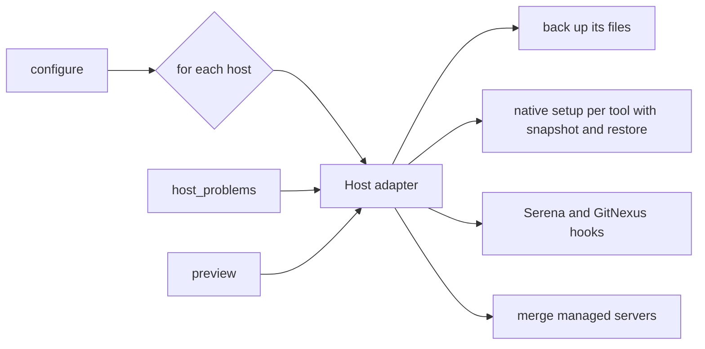

# Setup Tooling Architecture And Design

## Design Goal

Keep piw walled off and give the rest of the repository its own pinned
checks; prove Windows logic with tools that run on Linux; then make the
setup script data-driven per host and per tool, with an end-to-end golden
test in place first so the restructure provably writes the same files. The
main tradeoff is effort now (a formatting commit, a fixture set, a module
split) for cheaper and safer changes later.

## Context And Boundaries

- `piw/` owns its own `pyproject.toml`, lock, ruff, pyright and tests. This
  work does not touch it.
- The repository root owns everything else: `scripts/`, the root `tests/`,
  `skills/*/scripts/`, the bootstrap scripts, `Taskfile.yml`, `mise.toml` and
  `agent-dependencies.json`.
- `scripts/manage_agent_tools.py` owns tool installation and agent
  configuration. `scripts/install_skills.py` owns skills and is unchanged
  here.
- Public contracts are in [SRD.md](SRD.md#public-contracts).

## Decisions And Alternatives

| Decision or option | Status | Reason |
| --- | --- | --- |
| Root `ruff.toml`; pyright configuration in `lint/pyrightconfig.json`, passed with `-p` | Accepted | Ruff uses the configuration nearest each file, so piw keeps `piw/pyproject.toml`. Pyright instead searches upward for `pyrightconfig.json` from where it runs, so a root file would replace piw's strict settings; one under `lint/` is never on piw's search path |
| Install ruff, pyright and `tomlkit` into `.tools/lint/` with `uv pip install --require-hashes` from a hash-pinned `lint/requirements.txt`, and run them from there | Accepted | `uv run --with-requirements` ignores `--hash` lines; `uv pip install --require-hashes` rejects a mismatch |
| Run the lint tools through `uv run --isolated --no-project --with-requirements`, like `agent-runtime.txt` | Rejected | Does not enforce the pinned hashes |
| Development-only tools (shellcheck, PowerShell 7) in a separate mise environment under `lint/` with its own lock, installed by `deps:dev-tools` | Accepted | `deps:tools` runs on every `install`; adding them to `mise.toml` would make every user, Windows included, download tools only the checks need |
| Add shellcheck and PowerShell to `mise.toml` | Rejected | Same reason |
| A root `pyproject.toml` with a dependency group and `uv.lock` | Rejected | Makes the root look like a uv project; Task runs Python with `--no-project`, and a root project could change how uv treats `piw/` |
| Extend or reuse piw's ruff and pyright settings | Rejected | The owner wants piw walled off; a shared base would couple the two |
| Start from piw's rule families; turn off missing-docstring rules D100 to D107; keep test per-file ignores as piw has them | Accepted | 80 of the 166 measured findings are missing docstrings on setup functions, which adds churn without value for scripts; other D rules still apply to docstrings that exist |
| Enable C901 (`max-complexity = 10`) for `manage_agent_tools.py` and any package split out of it, at the end of P5 | Accepted | Its 6 functions over the limit are what the restructure removes. `install_skills.py` (10 functions), `skills/` and `tests/` also exceed it, but restructuring them is out of scope |
| Pyright basic mode for Python outside piw, and strict mode for `manage_agent_tools.py` (and any package split out of it) from the end of P5 | Accepted | 13 basic-mode errors on the setup scripts today, 91 across the in-scope files; strict mode becomes practical once P4 and P5 add typed host and tool records. The owner chose strict for the setup script on 2026-11-06 |
| Resolve pyright imports: `tomlkit` installed in the lint environment; `tests/skill-evals` given its harness folder through `executionEnvironments` with `extraPaths`; `scripts/render_serena_config.py` excluded, because it runs inside Serena's environment with `ruamel.yaml` and `serena` | Accepted | Without this, 24 unresolved imports fail the check as soon as it runs |
| Exclude eval fixture projects (`tests/skill-evals/**/fixture/`) from lint | Accepted | They are sample repositories the evals act on; their code shape is part of each test case |
| One formatting-only commit listed in `.git-blame-ignore-revs` | Accepted | Keeps real changes reviewable and `git blame` useful |
| Lint and type-check targets: Python 3.11 for the setup scripts and tests, 3.10 for the two skill scripts that declare `requires-python >= 3.10` | Accepted | A 3.14 target let the formatter emit 3.14-only syntax (`except A, B:`) into scripts that must also run on older Pythons; the target is the oldest Python each file supports, and Task still runs them on 3.14 |
| Install pyright with its `nodejs` extra and pin the wrapper's environment variables in `lint:python` | Accepted | Otherwise pyright's PyPI wrapper uses any `node` on PATH or downloads an unpinned, unchecked Node into the home folder; the extra puts Node under the same hash pin |
| Per-file ignores beyond piw's for tests: docstring style (D205, D401), subprocess calls with fixed arguments (S603, S607), many positional fixture fields (PLR0917), typographic characters in test data (RUF001), and E501 only in `tests/test_plc_checkpoint_fixtures.py`; D205 and D401 for `skills/plc-planning/scripts/format_check.py` | Accepted | Each ignore states its reason in `ruff.toml`; the setup tests and eval harness share these patterns, and `format_check.py` documents its functions with noun phrases by design |
| Pin shellcheck and PowerShell through mise in `lint/mise.toml`, so `lint/mise.lock` records per-platform checksums; install them into their own data directory (`.tools/lint-mise/data`) | Accepted | Same pinning path as Task, uv and Node; a separate data directory keeps lint installs from rebuilding the shims the root tools use |
| A checkout whose `.tools/mise/data` physically lives in another checkout never runs `mise install`; it uses the tools already there or stops with an error naming the owner (`scripts/ensure_mise_tools.sh`) | Accepted | `mise install` rebuilds every shim to point at the mise that ran it, even when the install fails part way, so installing from a worktree that shares the data left the owner's shims pointing at a checkout that may be deleted. Reshimming afterwards was tried and rejected: a partial failure, a link at a parent folder, or a missing owner mise each left the shims wrong |
| Import Pester and PSScriptAnalyzer by exact path and check where they loaded from, before and after the run | Accepted | `pwsh` puts the user and shared module folders ahead of `PSModulePath`, so a user-installed copy would otherwise replace the pinned one |
| Apply `PSUseCompatibleCommands` only to the scripts that run on Windows PowerShell 5.1 | Accepted | `tests/powershell/*.Tests.ps1` and `lint/*.ps1` run on PowerShell 7 and call Pester and PSScriptAnalyzer commands no 5.1 profile lists |
| Download Pester and PSScriptAnalyzer `.nupkg` files by exact version and check a pinned SHA-256 before unpacking into `.tools/` | Accepted | The PowerShell Gallery has no lock file; `Save-Module` cannot verify a hash; Authenticode checks do not run on Linux |
| Test Windows logic with Pester under `pwsh` on Linux and Python tests that patch `os.name` | Accepted | Covers parsing, quoting and text generation, which is where the known defects are |
| PSScriptAnalyzer `PSUseCompatibleCommands` with its bundled Windows PowerShell 5.1 profile, beside `PSUseCompatibleSyntax` | Accepted | Also catches commands and parameters missing from 5.1 (it flags `Get-Content -AsByteStream`), not just syntax |
| Run Windows scripts under Wine | Rejected | Not installed; `cmd.exe` and Windows PowerShell 5.1 under Wine do not represent real behavior |
| Hosted Windows CI | Deferred | Adds a deliverable; the owner chose not now on 2026-11-06 |
| Split `bootstrap.ps1` into functions with a dot-source guard instead of a separate module | Accepted | Bootstrap must stay one file a user can download and run; the guard lets tests load functions without running it |
| One adapter record per host, plus one installer handler per installer type | Accepted | Puts each host's and tool's details in one place, which the audit and REQ-017 and REQ-019 require |
| A plugin registry or class hierarchy for hosts and tools | Rejected | Four hosts and three installer types do not need dynamic loading; plain records and functions are enough |
| Keep `agent-dependencies.json` at `schema_version` 1 and add required fields | Accepted | The file and the code that reads it change in the same commit in one repository; a version bump would add a migration path with no reader |

## Fixed Constraints And Implementation Choices

Required:

- No file under `piw/` changes (REQ-002).
- Setup output is byte-for-byte unchanged across P4 and P5 (REQ-016,
  REQ-020).
- Every new tool or module version is pinned, and downloads without a lock
  are checked against a pinned SHA-256.
- Suppressions name a rule and a reason (REQ-006).
- Example paths and names in tests and fixtures are invented (`/home/user`,
  `C:/Users/O’Brien`).

Suggested, left to the implementer:

- P1 runs before P2 and P3: its formatting commit touches the same files.
- Splitting `manage_agent_tools.py` into a small package (for example
  `scripts/agent_setup/` with `hosts.py`, `tools.py`, `files.py`,
  `configure.py`, `doctor.py`), keeping `scripts/manage_agent_tools.py` as the
  entry point. If split, tests import through the entry point's folder on
  `sys.path`.
- Representing host adapters and tool specs as frozen dataclasses.
- File names for the pinned PowerShell module list and the golden fixtures.

## Building Blocks

| Component | Responsibility | Changed behavior |
| --- | --- | --- |
| `ruff.toml`; `lint/` (pyright configuration, hash-pinned requirements, development-only mise environment and module pins) | Lint, format and type rules and tool versions for Python outside piw and the shell and PowerShell checks | New |
| `Taskfile.yml` | `deps:dev-tools`, `lint:python`, `lint:shell`, `lint:powershell`, `test:powershell`; `check` and `ci` run the checks | Changed |
| `bootstrap.ps1` | Checksum lookup and `task.cmd` text become functions; CRLF output; dot-source guard | Changed |
| `scripts/run_gitnexus_hook.mjs`, PowerShell quoting in setup | Escape every PowerShell single-quote character | Changed |
| Host adapter | Paths, server read and write, env key, command shape, Serena context, hooks file for one host | New |
| Installer handlers (`uv`, `npm`, `github-release`) | Install, command, version and latest version for tools of that type | New |
| `configure()` | Sequence of steps: back up, native setup per tool, hooks, merge, migrate | Changed: shorter, same output |
| `agent-dependencies.json` | `installer` and `bin` per tool | Changed: additive |

## Runtime And Data Flow

### Lint and type checks

`deps:dev-tools` installs `lint/requirements.txt` into `.tools/lint/` with
`--require-hashes`. `task lint:python` runs `ruff check` and
`ruff format --check` from the repo root (the root `ruff.toml` applies by
nearest-config lookup and excludes `piw/` and eval fixtures), then
`pyright -p lint/pyrightconfig.json`. Paths in that file resolve from `lint/`
(for example `../scripts`). Its top-level `strict` list applies strict mode to
`manage_agent_tools.py` and any package split out of it from the end of P5
(REQ-022); every other file stays on basic mode. Any finding exits non-zero,
which stops `check` and `ci`.

### Windows checks from Linux

`deps:dev-tools` installs the pinned `pwsh` and shellcheck through the
separate mise environment, then downloads the Pester and PSScriptAnalyzer
`.nupkg` files, checks each SHA-256, and unpacks them into
`.tools/powershell-modules/`. `lint:powershell` runs PSScriptAnalyzer with
that folder as the only module path and the 5.1 syntax and command rules
enabled. `test:powershell` runs Pester, which dot-sources `bootstrap.ps1`
(its guard keeps the main function from running) and calls its functions. The Python
Windows tests patch `os.name` to `"nt"` and check the exact commands built.

### End-to-end test

A temporary home is filled from FIX-001 to FIX-004, and a fake `TOOLS`
folder holds executables that stand in for the upstream installers and the
tools' version probes (FIX-005), including a stand-in for Serena's
environment Python. The test fixes `PATH`, `LLMS_ORIGINAL_PATH`,
`SERENA_HOME` and the temp root through the environment, so nothing depends
on this machine or on internal function names. `configure("all")` runs twice;
the test replaces machine paths in the written files with placeholders,
compares them with the golden copies (FIX-006), and checks the second run
changes no file's bytes or mode. It runs on POSIX only.

### Host adapters

`configure`, `preview` and `host_problems` all read host details from the
same adapter, so they cannot disagree about where a host keeps its servers.

### Tools from the manifest

Each `tools.<name>` entry names its installer. The installer handler builds
the install command, the command used to run the tool, and the version and
latest-version lookups. `npm_package()` lists every entry whose installer is
`npm`. `--tool` choices come from the manifest's keys.

## Quality And Safety

- The end-to-end golden test is the guard for user config. P4 and P5 may not
  edit golden files; any needed change to them is a behavior change and needs
  the owner's approval.
- The existing backups and the restore-only-servers behavior stay as they are.
- Lint and type tools run in isolated environments and write nothing outside
  `.tools/` and caches.

## Test Design

- P1: the lint tasks themselves are the checks; REQ-004 uses a known failure
  in a scratch worktree.
- P2: Pester tests for `bootstrap.ps1` functions; Python and Node tests for
  quoting with FIX-007; PSScriptAnalyzer and shellcheck runs, each with one
  known failure (FIX-008) to prove the check detects it.
- P3: the end-to-end golden test, written against the current code and
  passing before any restructure, faking only executables and environment so
  P4 and P5 cannot need to edit it.
- P4 and P5: the golden test unchanged; a fake-host test (REQ-017); a
  fake-tool and bad-installer test (REQ-019); the before-and-after dry-run
  comparison (REQ-020).

## Deferred Work

| Item | Reason | Follow-up owner or trigger |
| --- | --- | --- |
| Hosted Windows CI | Adds a deliverable | @nccurry, when Windows use of this setup becomes regular |
| Sharing the host list and skill checks with `install_skills.py` | Outside the approved restructure | @nccurry, when `install_skills.py` next changes |
