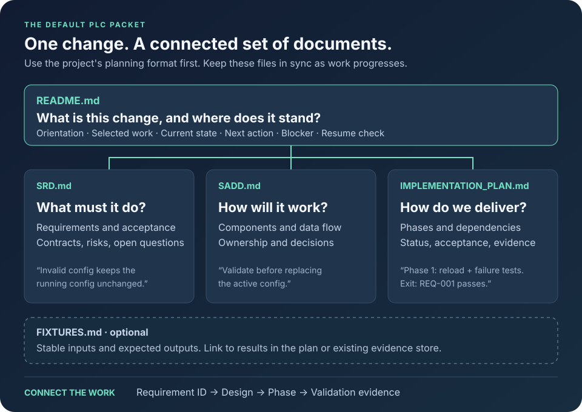

# Skill workflows

[Back to the README](../README.md#use-the-skills).

Use this guide to write a change plan, choose implementation agents, and take a
feature through review and delivery. A PLC (Plan-Led Change) records requirements,
design, delivery steps, and checks.

- [Write a change plan](#write-a-change-plan)
- [Choose an execution model](#choose-an-execution-model)
- [Example: take a feature through delivery](#example-take-a-feature-through-delivery)
- [Keep these habits throughout](#keep-these-habits-throughout)
- [Run the Claude workflows](#run-the-claude-workflows)

## Write a change plan

Use the project's planning format first. Otherwise, start with the
[default packet](../skills/plc-planning/assets/default-packet/README.md) for larger
changes, or the [compact plan](../skills/plc-planning/assets/compact-plan.md) for smaller changes:



```text
REQ-001: Invalid config leaves the running config unchanged.
Design:  Parse and validate before replacing the active config.
Phase 1: Implement reload; test invalid input; record the result.

Current: Implementation complete; local checks passed; PR unmerged; record complete.
Next:    Finish required PR reviews.
```

Keep requirement IDs stable. Replace the current-work block as work changes.
Record each result once and link to it. If a record is missing, check existing
results before running checks again.

## Choose an execution model

All four monitored workflows reuse [plc-execution](../skills/plc-execution/SKILL.md).
The main agent assigns work, reviews the code, and combines the changes.

| Skill | Main agent | Implementation agents | After a verified serious delivery failure |
|---|---|---|---|
| [monitored-luna-plc-execution](../skills/monitored-luna-plc-execution/SKILL.md) | Current model | GPT-6 Luna, max | Switch repairs and new implementation agents to GPT-6.1 Sol, medium. |
| [monitored-sol-plc-execution](../skills/monitored-sol-plc-execution/SKILL.md) | Current model | GPT-6.1 Sol, medium | Repair with Sol. |
| [monitored-sonnet-plc-execution](../skills/monitored-sonnet-plc-execution/SKILL.md) | Opus | Sonnet | Switch repairs and new implementation agents to Opus. |
| [monitored-opus-plc-execution](../skills/monitored-opus-plc-execution/SKILL.md) | Opus | Opus | Repair with Opus. |

Your agent app must support the selected models and subagents. Ordinary bugs and review
corrections stay with the assigned model.

## Example: take a feature through delivery

```text
$plc-planning Plan config reloads. Show expected behavior, failure cases,
phases, and how each requirement will be verified.

$review-and-fix-plc Review that packet and fix supported findings.

$monitored-sol-plc-execution Implement phase 1 only. Include tests and docs.
Use an isolated worktree and open a PR to main. Do not merge it.

$plc-checkpoint Record phase 1's checks, PR state, and remaining work.
```

After approval to merge:

```text
$wrap-this-up Complete the agreed PR delivery after required checks pass.
Verify main, update the PLC, and remove eligible task-owned worktrees.
```

## Keep these habits throughout

| Skill | What it looks like |
|---|---|
| [plain-english](../skills/plain-english/SKILL.md) | “Reload keeps the old config if validation fails.” |
| [design-for-change](../skills/design-for-change/SKILL.md) | “Keep parsing separate from applying the config.” |
| [verify-before-claiming](../skills/verify-before-claiming/SKILL.md) | “Local checks passed; CI is pending; the PR is unmerged.” |

Use focused specialists for focused questions: [audit-tests](../skills/audit-tests/SKILL.md)
for missing coverage, [test-quality-audit](../skills/test-quality-audit/SKILL.md) for weak
tests, and [docs-sync](../skills/docs-sync/SKILL.md) for documentation drift.
During authorized implementation, the combined audit uses specialist reviewers and
fixes confirmed problems within the agreed scope. Repeat an audit only after a
serious finding or substantial change; stop after three consecutive passes.

## Run the Claude workflows

The main agent arranges independent audits, fixes confirmed problems within the
agreed scope, and reviews the code before combining changes. Both workflows keep
Claude’s configured effort unless you choose another setting. Model names such as
`opus` use the family alias; a version you explicitly request takes precedence.

Invoke them in Claude Code as `/monitored-sonnet-plc-execution` or
`/monitored-opus-plc-execution` with the selected PLC work. Their `model: opus`
setting requests Opus for the current turn. Use `/model opus` or start with
`claude --model opus` to keep the session on Opus across follow-up turns. Other
agent apps must support the requested Claude models and subagent model selection
to run these workflows.
