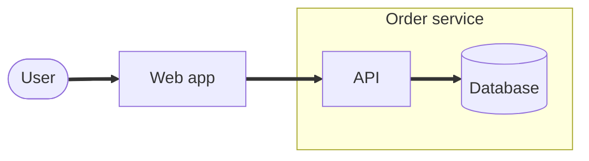
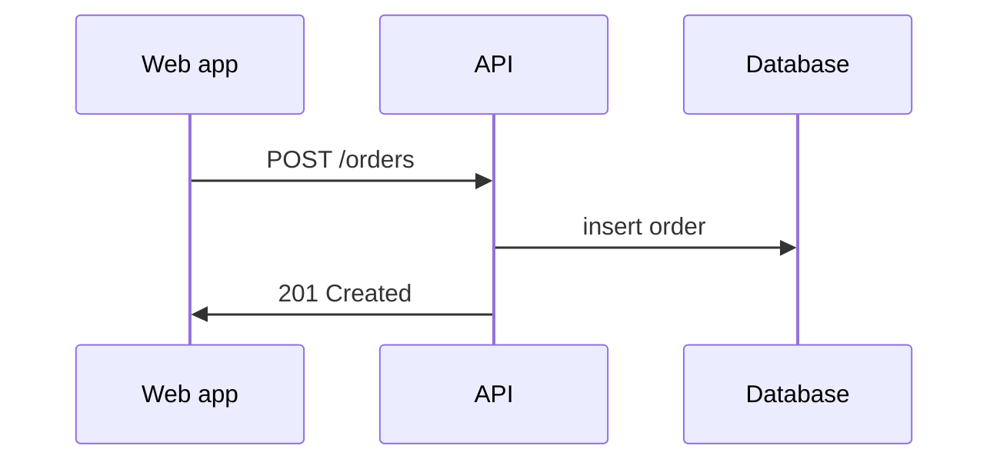
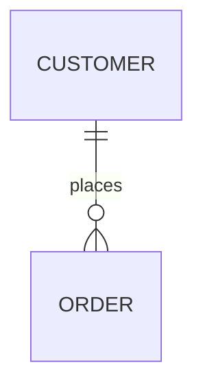

# <Feature> Architecture And Design

## Design Goal

State the chosen design and its main tradeoff.

## Context And Boundaries

Name the affected components. State what each owns and what remains outside its
responsibility. Link to the public contracts in `SRD.md` or their existing source.

<!-- Optional: a small diagram of the components and their boundaries.
Copy it out of this comment with the plan's own names, or delete the comment.
Arrows here are ==> because `--` followed by `>` would end this comment. In
a plan, flowcharts use `--` followed by `>`.

-->

## Decisions And Alternatives

| Decision or option | Status | Reason |
| --- | --- | --- |
| <decision or alternative> | <proposed, accepted, rejected, or deferred> | <tradeoff and authority when approval is needed> |

## Fixed Constraints And Implementation Choices

Name the public contracts, safety rules, and ownership boundaries that must
hold. Leave routine internal choices open unless a concrete constraint requires
them. Distinguish a suggested implementation from a required design decision.

## Building Blocks

| Component | Responsibility | Changed behavior |
| --- | --- | --- |
| <component> | <responsibility> | <change> |

## Runtime And Data Flow

Describe the main path from input to result. Include failure, retry, restart,
or recovery paths when they change behavior. Explain internal data and state
ownership without repeating public contract definitions or experience examples.

<!-- Optional: a sequence diagram for a flow across parts, or an ER diagram
for stored data. Copy one out of this comment with the plan's own names, or
delete the comment. The reply here is ->> because `--` followed by `>>`
would end this comment. In a plan, replies use `--` followed by `>>`.

-->

## Quality And Safety

Describe the design choices for the quality attributes in `SRD.md`. Include
trust boundaries, concurrency, cancellation, recovery, and resource limits
when they apply.

## Test Design

Explain which unit, integration, end-to-end, visual, or manual checks prove the
design. Use existing test facilities where they suffice. Each requirement's
check lives with the requirement in `SRD.md`; results go under their phase in
`IMPLEMENTATION_PLAN.md`.

## Deferred Work

Design items left for later. A deferred phase stays in the README `## Phases`
table, marked `Deferred — <reason>`.

| Item | Reason | Follow-up owner or trigger |
| --- | --- | --- |
| <item> | <reason> | <owner or when to revisit> |

Required acceptance cannot be moved here merely to declare completion.
